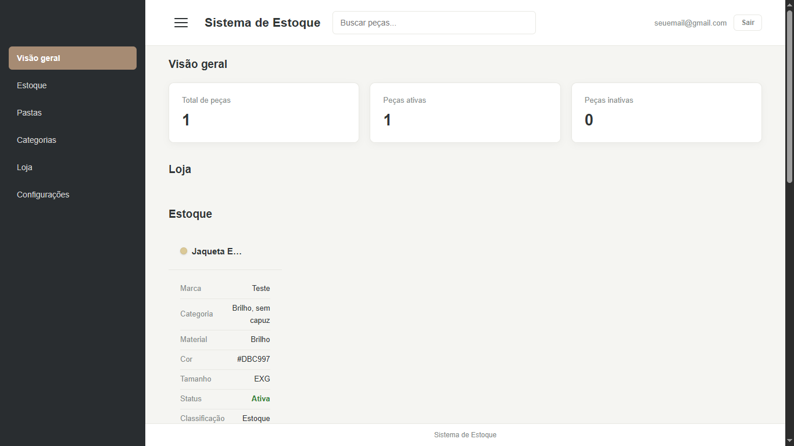
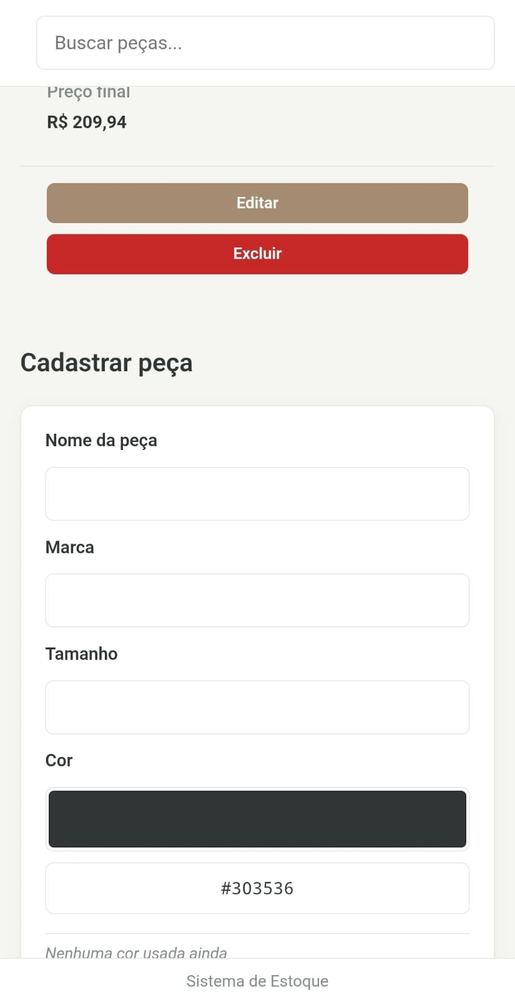

# Sistema de Estoque - Loja & Estoque

> ⚠️ **Versão experimental** — Em desenvolvimento ativo, pode conter bugs ou mudanças quebradas.

Sistema completo de gerenciamento de peças para loja e estoque, com autenticação, busca em tempo real, tags e deploy no Firebase.

## 🚀 Demo
- **Firebase Hosting:** https://estoque-loja-e121f.web.app
- **GitHub Pages:** https://sarahsouza355.github.io/estoque02/

## ✨ Funcionalidades
- 🔐 **Autenticação** (Firebase Auth - email/senha)
- 📦 **CRUD de peças** (nome, marca, tamanho, cor, categoria, material, preço, desconto)
- 🏷️ **Tags/Palavras-chave** múltiplas com sugestões do histórico
- 🔍 **Busca em tempo real** (nome, marca, categoria, tags, etc.)
- 📱 **Mobile-first** (≤650px: sidebar removida, busca full-width)
- 📂 **Pastas** para organizar peças
- 🏪 **Classificação** Loja / Estoque com visão geral unificada
- 🔒 **Dados isolados por usuário** (Firestore Rules)
- ☁️ **Tempo real** (onSnapshot listeners)

## 💡 Contexto
Desenvolvido para **gerenciamento de estoque pessoal/profissional**, adaptável para pequenos comércios, lojas ou uso individual.

## 🛠️ Tech Stack
- **Frontend:** HTML5, CSS3 (variáveis, grid/flex, mobile-first), Vanilla JS
- **Backend:** Firebase Auth + Firestore (real-time)
- **Hosting:** Firebase Hosting / GitHub Pages
- **Deploy:** `firebase deploy --only hosting`

## 📱 Screenshots
| Desktop | Mobile |
|---------|--------|
|  |  |

## ⚙️ Setup Local
```bash
# 1. Clone
git clone https://github.com/SarahSouza355/estoque02.git
cd estoque02

# 2. Configure Firebase
# - Crie projeto no console.firebase.google.com
# - Ative Authentication (Email/Password)
# - Crie banco Firestore
# - Copie config para os HTMLs (já está no código)

# 3. Deploy rules
firebase deploy --only firestore:rules

# 4. Deploy hosting
firebase deploy --only hosting
```

## 🔒 Segurança
- `firestore.rules`: cada usuário acessa apenas seus dados (`request.auth.uid == userId`)
- `.gitignore` protege service accounts, .env, credenciais
- Firebase Config nos HTMLs é **público por design** (necessário no frontend)

## 📄 Licença
MIT